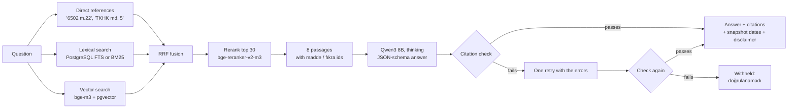

# Finansal Haklar Asistanı: a citation-verified RAG over Turkish banking law

A question-answering assistant for Turkish banking and consumer-finance law. It answers in
Turkish and cites the article and paragraph (madde/fıkra) it relies on. Every citation is
checked against the source text before the answer is shown. An answer whose citations do not
check out is **withheld** ("doğrulanamadı"), never shown unverified.

It runs locally and for free:
- **Language model:** Qwen3 8B through Ollama.
- **Search models:** bge-m3 embeddings and the bge-reranker-v2-m3 cross-encoder.
- **Index:** PostgreSQL with pgvector.

> **Not legal advice.** The texts are a snapshot: mevzuat.gov.tr on 23.10.2026, and the TCMB
> Talimat of 13.01.2026. Every answer carries this notice and the date of its sources.

```text
$ python scripts/ask.py "Kredi kartımı kapattırmak istiyorum ama kartta hâlâ borcum var. Banka iptali reddedebilir mi?"
Banka, kredi kartı iptal talebinde borç bakiyesi nedeniyle reddedemez. ...

Kaynaklar:
[1] Ücret Tebliği Uygulama Talimatı (TCMB, 13.01.2026) md. 8 (c)
    “Finansal tüketicinin kredi kartı iptal talepleri, ilgili kredi kartıyla ilişkilendirilen
    herhangi bir borç bakiyesi bulunduğu gerekçe gösterilerek reddedilemez.”
    13.01.2026 tarihli sürüm, 23.10.2026 tarihinde alındı. https://www.tcmb.gov.tr/...
[2] Finansal Tüketicilerden Alınacak Ücretler Tebliği (2020/7) md. 11/2
    “...”  mevzuat.gov.tr'deki metin, 23.10.2026 tarihinde alındı. https://www.mevzuat.gov.tr/...

Bu cevap mevzuat metinlerine dayanan bir bilgilendirmedir, hukuki tavsiye değildir. ...
```

## How it works



**Parsing.** The official texts are parsed into madde → fıkra → bent units. Amendment notes
(Değişik / Ek / Mülga) are kept with each unit. Repealed provisions are marked. Paragraph
numbers that the text does not print are counted, and the citation says so.

**The citation check.** It is deterministic. Every citation must:
- point to a passage the model was shown;
- match that passage's document, article and paragraph;
- quote it literally.

Every number in the answer must also appear in a cited passage or in the question.

**The disclaimer** is added by code, not by the model.

## Corpus (16 documents)

Collected at most one request per second per site, respecting robots.txt
(`scripts/fetch_sources.py`). The raw downloads are not part of the repository; the manifest
and the scripts re-create them.

| Laws | Tebliğ / Talimat / Yönetmelik |
|---|---|
| 6502 Tüketicinin Korunması Hakkında Kanun | TCMB Ücret Tebliği (2020/7) and its Uygulama Talimatı (13.01.2026) |
| 5411 Bankacılık Kanunu | Tüketici Kredisi Sözleşmeleri Yönetmeliği |
| 5464 Banka Kartları ve Kredi Kartları Kanunu | Banka Kartları ve Kredi Kartları Hakkında Yönetmelik (BDDK) |
| 6493 Ödeme Hizmetleri ve Elektronik Para Kanunu | Konut Finansmanı Sözleşmeleri Yönetmeliği |
| 6698 Kişisel Verilerin Korunması Kanunu | Ödeme Hizmetleri ve Elektronik Para İhracı Yönetmeliği (TCMB) |
| | Tüketici Hakem Heyetleri Yönetmeliği |
| | Finansal Hizmetlere İlişkin Mesafeli Sözleşmeler Yönetmeliği |
| | Tüketici Sözleşmelerindeki Haksız Şartlar Hakkında Yönetmelik |
| | Mevduat ve Katılım Fonu Yönetmeliği (BDDK) |
| | Bankacılık Hizmetlerinin Erişilebilirliğine Dair Yönetmelik (BDDK) |

## Results

They are measured on 64 golden questions, written from the corpus and **approved by the
owner**. The questions fall into six types: direct, multi-article, numeric, amended
provisions, out of scope and false premise. The numbers are small; read them as such.

**Retrieval** (`eval/results/2026-10-29_171837_retrieval_golden`). Recall is counted at
article level:

| Config | R@5 | R@10 | MRR |
|---|---|---|---|
| PostgreSQL FTS alone | 0.30 | 0.39 | 0.28 |
| bge-m3 vector alone | 0.82 | 0.88 | 0.68 |
| FTS + vector + rerank + direct refs (default) | 0.89 | 0.94 | 0.85 |
| BM25 + vector + rerank + direct refs | **0.91** | **0.97** | **0.86** |

**Answers**, first full run (`eval/results/2026-10-29_184334_e2e`, Qwen3 8B with thinking):

| | Result |
|---|---|
| Answers verified / withheld / refused | 47 / 9 / 8 |
| Out-of-scope questions refused | 6/8 |
| Answerable questions refused | 2/56 |
| Correct, per an LLM judge (Gemini 3.1 Flash-Lite) | 20/56 |
| Correct or partly correct, per that judge | 37/56 |
| Wrong, per that judge | 8/56 |
| False premises corrected | 5/6 |
| Latency per question (RTX 5060 Laptop, 8 GB) | p50 25 s, p95 74 s |

The judge compares each answer with the approved expected answer and its evidence. Refusals
and withheld answers are scored by rule.

How far to trust the judge:
- **Not calibrated.** It agreed with a hand reading on 8 of 11 answers. The per-answer
  agreement with the owner was not measured.
- **The owner's overall rating** of the answers is about 90/100.
- **What the citation check cannot catch:** a verified citation does not make an answer
  right. The check proves that the quote is in the cited article, not that the conclusion
  follows from it. Two kinds of error get through:
  - an added sentence with no source behind it;
  - a number read from the wrong column of a table.

The details, including the failures, are in [`docs/milestones/`](docs/milestones/).

## Run it

Requirements:
- Python 3.11 or newer (developed on 3.13);
- Docker, for PostgreSQL + pgvector;
- [Ollama](https://ollama.com);
- optionally an NVIDIA GPU. With 8 GB, keep `RETRIEVAL_DEVICE=cpu`: the language model needs
  the whole card, see M4.

```bash
python -m venv .venv
.venv/Scripts/activate              # Windows; source .venv/bin/activate elsewhere
pip install torch --index-url https://download.pytorch.org/whl/cu128   # or the CPU build
pip install -e ".[models,dev]"
cp .env.example .env                # settings; never commit .env

docker compose up -d db             # PostgreSQL + pgvector on 127.0.0.1:5433
python scripts/fetch_sources.py     # download the 16 documents (polite, cached)
python scripts/parse_sources.py     # → data/processed/chunks.jsonl
python scripts/build_index.py       # embeddings + full-text index
ollama pull qwen3:8b

python scripts/ask.py "Tüketici kredisini erken kapatırsam faiz indirimi yapılır mı?"
python scripts/search.py "kart aidatı iadesi" --config full   # retrieval only
```

**Evaluation** (everything is free):

```bash
python eval/run_retrieval.py                  # Recall@k / MRR for each search config
python eval/smoke_ask.py --all                # answer every golden question → eval/results/
python eval/judge.py eval/results/<run>_e2e   # judge: local Ollama model
python eval/judge.py eval/results/<run>_e2e --judge gemini --model gemini-3.1-flash-lite
python eval/hand_sheet.py make eval/results/<run>_e2e   # then: score
python eval/check_golden.py eval/drafts/batch2.jsonl    # checks for new golden questions
```

The Gemini judge needs `GEMINI_API_KEY` in `.env`. It is free only when the key's Google
project has no billing account.

**Tests:**

```bash
pytest -m unit
```

The full suite is `pytest`. It needs the database, and runs the model tests when the models
are installed.

## Status and limitations

Phase 1 ended on 2026-11-21:
- **Done:** M1 data collection, M2 parsing, M3 hybrid retrieval and its evaluation, M4
  answers with citation verification, and M5 in part.
- **M5 gaps:** 64 of the planned 150 golden questions; no bootstrap intervals or ablations
  yet.
- **Not built:** M6, the HTTP API, web page, app Docker image and CI. The assistant is a
  command-line tool.

Other limitations:
- The corpus is a snapshot of 16 documents; newer amendments are not in it.
- The model is an 8B one: it sometimes adds claims with no source behind them, or misreads
  tables. Answers that fail the citation check are withheld rather than shown.
- An LLM judge is biased and noisy; its numbers are indicative until checked against hand
  scores.

## License

MIT, see [LICENSE](LICENSE). The legislation itself is public; this repository contains the
code, the evaluation questions and the results, not the downloaded texts.

---

## Türkçe özet

**Finansal Haklar Asistanı**, Türk bankacılık ve tüketici mevzuatı üzerine çalışan bir soru
cevap sistemi.
- **Nasıl cevaplıyor:** Cevabı, dayandığı madde ve fıkraya atıf yaparak veriyor. Her atıf,
  cevap gösterilmeden önce kaynak metinle karşılaştırılıyor. Atıfları doğrulanamayan cevap
  gösterilmiyor; kullanıcı "doğrulanamadı" mesajını görüyor.
- **Ne kullanıyor:** Her şey yerel ve ücretsiz: Ollama üzerinde Qwen3 8B, bge-m3 ile
  bge-reranker-v2-m3 ve PostgreSQL + pgvector.
- **Korpus:** 16 belge: 5 kanun ile TCMB, BDDK ve Ticaret Bakanlığı'nın tebliğ, talimat ve
  yönetmelikleri. Metinler 23.10.2026 tarihli bir anlık görüntü. Cevaplar hukuki tavsiye
  değildir.

**Sonuçlar**, onaylı 64 soruluk golden set üzerinde:
- **Arama:** BM25 ile madde düzeyinde R@10 0,97.
- **Cevaplar (ilk tam çalıştırma):** 47 cevap doğrulandı, 9'u geri tutuldu, 8'i reddedildi.
  Kapsam dışı soruların 6/8'i reddedildi.
- **Hakem puanı (Gemini 3.1 Flash-Lite):** 20/56 doğru, 37/56 doğru ya da kısmen doğru.
- **Proje sahibinin genel değerlendirmesi:** yaklaşık 90/100.

Sınırlar:
- Hakem, cevap cevap elle puanlamayla kalibre edilmedi.
- Golden set planlanan 150 sorunun 64'ünde kaldı.
- HTTP API ve web arayüzü (M6) yapılmadı; sistem komut satırından çalışıyor.

Kurulum ve komutlar yukarıda, "Run it" bölümünde. Milestone raporları
[`docs/milestones/`](docs/milestones/) klasöründe.
